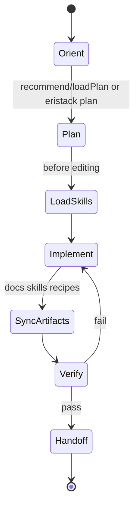

# Canonical agent workflow (draft spec)

**Purpose:** One state machine humans and agents follow for **library** work in business-libs. Cursor rules and skills should **converge** here; enforcement in phase 2.

## States



## Step 0 — Orient

- Read task or ticket; if multi-package, load `@eristack/ai-knowledge#package-relationships`.
- For stabilization program work, read `redesign/README.md` + active task in `tasks.yaml`.

## Step 1 — Plan

```bash
pnpm eristack plan --json
```

Or:

```ts
import { recommend, loadPlan } from "@eristack/ai-knowledge";
const plan = loadPlan(recommend(["your product language"]));
// load each skill in plan before coding that area
```

## Step 2 — Load skills (before files)

Match `AGENTS.md` intent entry — run the `pnpm dlx @tanstack/intent@latest load …` command.

## Step 3 — Implement

- Minimize scope; match examples (`examples/express`, etc.).
- Money/timestamps as strings; Drizzle at compose root (`openDrizzle`).
- No git operations unless user explicitly requests.

## Step 4 — Sync artifacts (same change set)

| If you changed… | Run |
| --- | --- |
| `package.json` deps | `pnpm lockfile:sync` |
| `docs/*.md` pages | `pnpm docs:sync` |
| skills / recipes / knowledge | `pnpm knowledge:sync` |
| exports | `pnpm build && pnpm exports:check` |
| new package with skills | `pnpm exec intent install --map` |

## Step 5 — Verify

```bash
pnpm eristack check --profile pr --skip-build   # quick
pnpm prepush                                      # affected CI
# or full:
pnpm eristack ci --base origin/main
```

Record commands in PR / task notes.

## Step 6 — Handoff

- Promote `_ai-docs/wip/` → package docs; delete wip.
- Update `redesign/tasks.yaml` state if program task.
- User owns commit/PR.

## Artifacts by task type

| Task type | Required outputs |
| --- | --- |
| Bug fix | tests, changeset if user-facing, skill/doc if behavior agents must know |
| New API | docs getting-started, skill, recipe if discoverable |
| Cross-cutting | one `knowledge/<topic>.md`, one skill, recipe pointer |
| Program STAB | findings register + task state only in `redesign/` until repo change approved |

## Anti-patterns

- Reading every package `docs/backseat.md` for upgrades (use `#upgrading-eristack` only).
- Hand-editing `src/generated/catalog.ts`.
- Shipping memory store as default in skills/recipes.
- Finishing with docs but stale `knowledge:check`.
